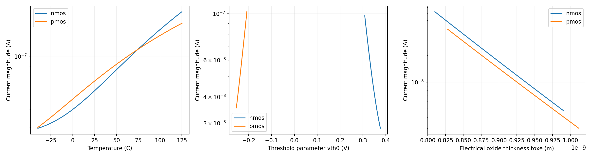
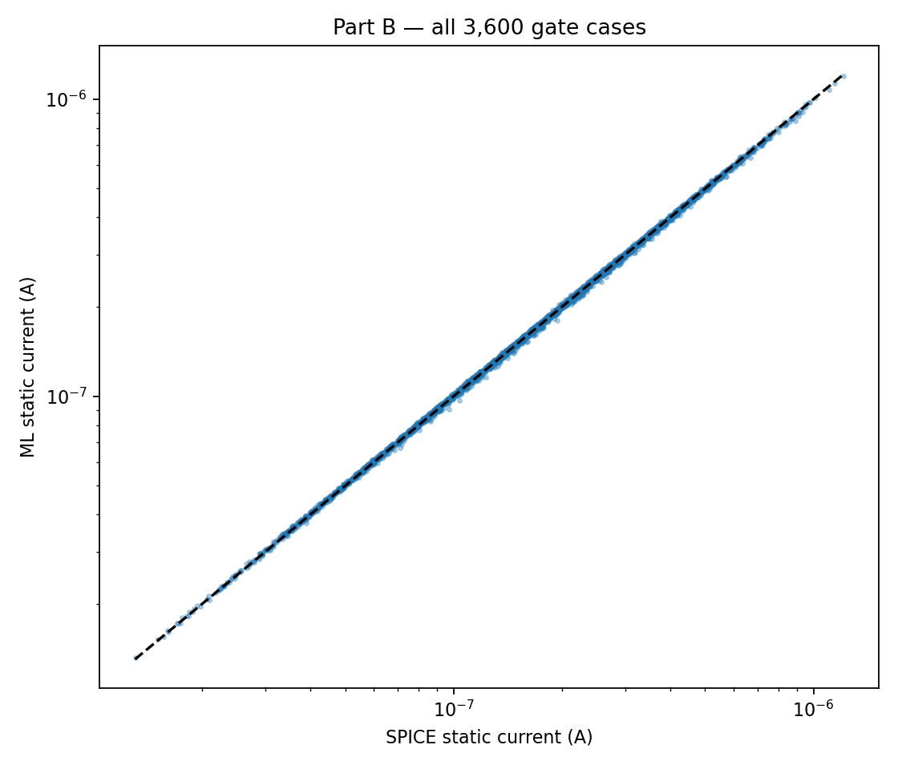

# Triode: Parts A and B — review package

## Setup and Part A data generation

Team Triode: supplied 45nm_MGK model, nominal VDD 1 V, assigned 3-bit CLA for Part C. All MOS channel lengths are 45 nm. SPICE references were generated with ngspice 45.2.

For each of NMOS ON/OFF and PMOS ON/OFF, 10,000 independent random transistor examples were first drawn. VDD was uniform on 0.9–1.1 V; temperature on −40–125 °C; W on 45–360 nm; and Vd and Vs independently on 0–VDD. The five model parameters vth0, toxe, ndep, u0 and xj were each drawn independently within ±10% of their separate NMOS or PMOS nominal values. Vg/Vb followed the four fixed case biases in the project PDF. Each transistor netlist placed its drain, gate, source and body on separate voltage sources and set the required ngspice options. Four signed terminal currents were recorded per row.

The original 10,000 rows per case use fixed 70/15/15 training, validation and test splits (7,000/1,500/1,500). A second independently uniform 10,000-row set per case was added for refinement; combined training/validation/test counts are 14,000/3,000/3,000. Split indices are saved. Original test results appear in the main table; supplementary test metrics are in the refinement folders.

KCL was checked by summing Id+Ig+Is+Ib. The largest absolute residual across the original datasets was 9.49e−15 A; the largest relative residual was 4.67e−5, at very small total current. The three required temperature, threshold and oxide-thickness trends are shown in checks/physical_trends.png.

The four baseline algorithm families use the original 7,000 training rows per case. Final refinements use 14,000 distinct training rows with separate validation. The main transistor test table reports only the original 1,500 held-out rows; additional test metrics are saved in refinement folders. Small median-error advantages can coexist with worse R2 or tail errors. AND/OR internal inverter gate voltages are approximated by their logic rails because the four prescribed models fix Vg/Vb. These limitations must remain disclosed.

Assignment: 45 nm MGK, nominal 1 V. Part C (3-bit CLA) is outside this package.

## Measured Part B result

Across 3600 gate evaluations: median percentage error 0.7935%; mean percentage error 0.9649%; 95th-percentile error 2.3983%.
Nonpositive predictions: 0.

## Transistor held-out test results

| Case | Selected method | Median error % | 95th percentile % | R2 |
|---|---|---:|---:|---:|
| nmos_on | wider_independent_conserving_MLP | 0.4620 | 2.5727 | 0.999677 |
| nmos_off | zero_bias_normalized_MLP | 0.4370 | 6.3731 | 0.982659 |
| pmos_on | wider_independent_conserving_MLP | 0.3908 | 2.0608 | 0.999938 |
| pmos_off | zero_bias_normalized_MLP | 0.3514 | 5.1412 | 0.987355 |

## Gate/input results

| Gate | Input | Median error % | Mean error % | 95th percentile % |
|---|---|---:|---:|---:|
| INV | 0 | 1.0577 | 1.2539 | 3.1548 |
| INV | 1 | 0.6585 | 0.8296 | 2.1557 |
| NAND2 | 00 | 1.7382 | 1.6451 | 2.5419 |
| NAND2 | 01 | 0.7377 | 0.9851 | 2.8919 |
| NAND2 | 10 | 1.2293 | 1.2301 | 2.3527 |
| NAND2 | 11 | 0.6558 | 0.8286 | 2.1469 |
| NOR2 | 00 | 1.0481 | 1.2477 | 3.1544 |
| NOR2 | 01 | 0.7897 | 0.8534 | 1.8242 |
| NOR2 | 10 | 0.5226 | 0.7956 | 2.2797 |
| NOR2 | 11 | 0.7349 | 0.9539 | 2.6207 |
| AND2 | 00 | 0.8235 | 0.8858 | 1.8255 |
| AND2 | 01 | 0.6033 | 0.7782 | 2.0478 |
| AND2 | 10 | 0.6401 | 0.7058 | 1.6787 |
| AND2 | 11 | 0.6003 | 0.7690 | 2.0655 |
| OR2 | 00 | 0.8445 | 1.0689 | 3.3445 |
| OR2 | 01 | 0.7525 | 0.8362 | 1.8451 |
| OR2 | 10 | 0.6372 | 0.7867 | 2.0598 |
| OR2 | 11 | 0.6827 | 0.9154 | 3.1611 |

## Fresh, independent gate corners

Frozen selected models were evaluated on 3600 additional gate cases using seed 20261211: mean error 0.8813%, median 0.6916%, 95th percentile 2.1781%, nonpositive predictions 0.
These reference currents were never used for transistor fitting or selection. The earlier 200-corner gate set guided development decisions, so the fresh set is the stronger generalization check.

## Error analysis

Best gate/input by mean percentage error: AND2 10 (0.7058%). Worst: NAND2 00 (1.6451%).

The gate operating voltages often lie at or extremely close to the supply rails, whereas uniform transistor samples predominantly lie in the interior. This makes boundary generalization a limitation even when random held-out transistor errors are small. Predicted ON drain/source currents can be much larger than the net leakage, making direct subtraction ill-conditioned. The verified KCL aggregation avoids that subtraction. No fitted correction based on gate reference leakage is applied.

## Baseline model settings

- Polynomial ridge: standardized inputs, degree 3, alpha 0.01.
- Extra Trees: 150 trees, minimum leaf size 1, fixed random seed.
- Histogram gradient boosting: independent regressors per target, 150 iterations, 31 leaves, L2=0.1.
- Initial neural network: standardized inputs, 96x96 tanh layers, up to 500 iterations, early stopping. Refined neural variants and validation scores are recorded in selection_comparison.csv; four_method_comparison.csv reports the four algorithm families.
- Baseline signed log-magnitude models normalize current by width and learn signs separately. All predictions and reference values are retained without clipping negative gate leakage.

## Verification and interpretation

- The supplied model was verified byte-for-byte against model/45nm_MGK.pm in the downloaded archive. Its SHA256 is 4cda7bf16d5ca8eccaa0b8656ff8708f881f7f3c26cb706b7e9dcd465d5d0280.
- Four independent 10,000-row random transistor datasets; 70/15/15 splits with saved row indices. Gate results were not used for fitting or validation-based model selection.
- Four required baseline algorithm types were compared. Additional neural refinements were chosen using transistor validation error only. Held-out test metrics are reported, not used for model selection.
- Percentage error is 100*abs(pred-reference)/max(abs(reference),1e-18 A). Both current signs and raw predictions are retained; no negative predictions are silently clipped. R2 is a separate metric.
- Primary gate leakage is total positive-rail static current, including high input-source currents. VDD-only reference and prediction are also saved.
- Gate current is assembled at a KCL cut around the conducting high-rail component. This avoids subtracting poorly predicted large ON currents at tiny drain-source differences. The derivation was independently checked using SPICE current probes for each gate/input example.
- Internal and output voltages are supplied by SPICE, as allowed by Part B. These are reused, not independently predicted by ML.
- Gate sizing: NMOS 90 nm, PMOS 180 nm, all lengths 45 nm. All NMOS share one process draw per corner and all PMOS another.
- AND2 and OR2 references are complete cascaded transistor netlists. Intermediate inverter gate voltages are represented by their logic-state transistor model.
- The supplied oxide-parameter combination is retained. Ngspice may ignore dtox when inconsistent with explicit toxe and toxp. Only the five assigned process parameters were varied.
- High R2 does not establish 1% error. If the measured error exceeds target, this package is an implementation and evidence package, not a claim of target achievement.
- See checks/audit.json, checks/boundary_identity.json and gates/reference_checks.json for independent checks.

## Files and reproduction

Run commands from this folder with Ubuntu Python and ngspice 45.2. Required Python libraries are NumPy, SciPy, scikit-learn 1.7.2, joblib and matplotlib. Saved model loading should use matching versions.

1. python3 generate_data.py --samples 10000 --workers 8
2. python3 check_data.py
3. python3 train_models.py
4. python3 refine_neural.py
5. python3 continue_neural.py
6. python3 refine_uniform.py
7. python3 refine_conserving.py
8. python3 continue_conserving.py
9. python3 refine_residual.py
10. python3 refine_independent.py
11. python3 refine_wider.py
12. python3 refine_normalized.py
13. python3 gates.py
14. python3 verify_boundary.py
15. python3 finalize_part_ab.py
16. python3 evaluate_fresh_corners.py
17. python3 package_results.py

The saved archive contains results and model files, so these long-running training commands are for intentional regeneration. On an extracted archive, move previous output folders before regenerating data: stages use completed-case checkpoints. Keep the provided saved split indices and gate seeds with their corresponding datasets.

## Final model choices

Four different baseline methods were evaluated for every transistor case on the original validation split. Their unmodified 16-row results are in final_results/four_method_comparison.csv. The selected refinements below were compared separately in final_results/selection_comparison.csv, using the combined original and additional transistor validation rows; gate reference currents were never used in that selection.
- nmos_on: wider_independent_conserving_MLP, selected for its lower transistor validation median percentage error (0.4692%).
- nmos_off: zero_bias_normalized_MLP, selected for its lower transistor validation median percentage error (0.4206%).
- pmos_on: wider_independent_conserving_MLP, selected for its lower transistor validation median percentage error (0.3983%).
- pmos_off: zero_bias_normalized_MLP, selected for its lower transistor validation median percentage error (0.3437%).

The final neural variants predict signed terminal currents through a current-conserving decomposition: positive conductance, gate-current magnitude, and body-current magnitude. The selected wider independent models train separate 96x96 tanh networks for these quantities. The selected zero-bias models normalize OFF-state gate and body current by their voltage-distance factors before fitting separate 64x64 tanh networks. The currents are reconstructed so Id+Ig+Is+Ib=0. All neural inputs and log targets are standardized; fitting uses L-BFGS with fixed seeds, validation-selected checkpoints, and no gate reference labels.

## Complete gate results table

Currents and bias are in amperes; bias is mean(ML minus SPICE).

| Gate | Input | SPICE median A | ML median A | Bias A | Median error % | 95th percentile % |
|---|---|---:|---:|---:|---:|---:|
| INV | 0 | 1.051516e-07 | 1.050659e-07 | 1.564364e-10 | 1.0577 | 3.1548 |
| INV | 1 | 1.151717e-07 | 1.145363e-07 | -6.482753e-11 | 0.6585 | 2.1557 |
| NAND2 | 00 | 1.100132e-07 | 1.125279e-07 | 2.142520e-09 | 1.7382 | 2.5419 |
| NAND2 | 01 | 1.320879e-07 | 1.320535e-07 | -2.429265e-10 | 0.7377 | 2.8919 |
| NAND2 | 10 | 8.788973e-08 | 8.806260e-08 | 6.920741e-10 | 1.2293 | 2.3527 |
| NAND2 | 11 | 2.300385e-07 | 2.287683e-07 | -9.529444e-11 | 0.6558 | 2.1469 |
| NOR2 | 00 | 2.099323e-07 | 2.097233e-07 | 2.993379e-10 | 1.0481 | 3.1544 |
| NOR2 | 01 | 1.782398e-07 | 1.795998e-07 | 1.019072e-09 | 0.7897 | 1.8242 |
| NOR2 | 10 | 9.498909e-08 | 9.544352e-08 | 4.276754e-10 | 0.5226 | 2.2797 |
| NOR2 | 11 | 7.271913e-08 | 7.181833e-08 | -9.014976e-10 | 0.7349 | 2.6207 |
| AND2 | 00 | 2.420113e-07 | 2.433122e-07 | 1.616375e-09 | 0.8235 | 1.8255 |
| AND2 | 01 | 2.498458e-07 | 2.492280e-07 | -1.369970e-09 | 0.6033 | 2.0478 |
| AND2 | 10 | 2.137940e-07 | 2.133515e-07 | -2.879687e-10 | 0.6401 | 1.6787 |
| AND2 | 11 | 3.482361e-07 | 3.480085e-07 | -1.256520e-09 | 0.6003 | 2.0655 |
| OR2 | 00 | 3.391178e-07 | 3.377647e-07 | -3.437405e-09 | 0.8445 | 3.3445 |
| OR2 | 01 | 2.760295e-07 | 2.745233e-07 | 8.055628e-10 | 0.7525 | 1.8451 |
| OR2 | 10 | 2.083101e-07 | 2.073772e-07 | 2.590061e-10 | 0.6372 | 2.0598 |
| OR2 | 11 | 1.804283e-07 | 1.793401e-07 | -8.529779e-10 | 0.6827 | 3.1611 |

## Four baseline algorithm families

These 16 validation results use the common original dataset and split; later neural variants are compared separately.

| Case | Method | R2 | Median error % | 95th percentile % |
|---|---|---:|---:|---:|
| nmos_on | polynomial_ridge | 0.987943 | 6.3518 | 27.5412 |
| nmos_on | extra_trees | 0.935164 | 11.6478 | 67.2695 |
| nmos_on | hist_gradient_boosting | 0.986489 | 4.5646 | 31.7824 |
| nmos_on | neural_network | 0.994103 | 4.9986 | 19.0619 |
| nmos_off | polynomial_ridge | 0.212769 | 15.5670 | 106.0236 |
| nmos_off | extra_trees | 0.673163 | 14.2198 | 69.3382 |
| nmos_off | hist_gradient_boosting | 0.952016 | 4.2762 | 41.5318 |
| nmos_off | neural_network | 0.903005 | 3.2756 | 18.9904 |
| pmos_on | polynomial_ridge | 0.981610 | 5.8540 | 23.4999 |
| pmos_on | extra_trees | 0.955414 | 10.4858 | 58.4307 |
| pmos_on | hist_gradient_boosting | 0.992695 | 4.0304 | 29.1222 |
| pmos_on | neural_network | 0.995543 | 3.9421 | 13.8027 |
| pmos_off | polynomial_ridge | 0.644409 | 14.9814 | 103.5366 |
| pmos_off | extra_trees | 0.807229 | 13.4382 | 64.5922 |
| pmos_off | hist_gradient_boosting | 0.912744 | 4.1401 | 44.4147 |
| pmos_off | neural_network | 0.855855 | 3.1726 | 16.5369 |

## Figures

## Corner-level error analysis and limitations

The largest mean error across all 18 gate/input cases at one original corner was corner 17: 3.343% at 77.81 °C, VDD 0.9434 V and NMOS vth0 0.31642 V. Other high-error corners include 29 (2.381%, 103.62 °C, NMOS vth0 0.30937 V) and 161 (2.337%, 105.62 °C, NMOS vth0 0.31131 V). The worst gate/input combination by mean error is identified in the gate analysis above. These observations suggest sensitivity to hot corners and low NMOS threshold; they do not establish a single cause.

Uniform transistor sampling sparsely covers exact supply rails used by logic gates. Current magnitudes span many orders, and some individual transistor body-current tails remain harder to fit than the overall median. The refined models use physical current conservation, signed current reconstruction, width normalization and logarithmic targets; future improvement would use better transistor-only validation near these operating conditions while respecting the prescribed sampling distribution. Gate internal voltages are supplied by SPICE in Part B, so this validation does not test an independent voltage predictor. The course-defined Part C circuit and its comparison remain outside this Part A/B report.

Current-conserving refinement: ConservingModel predicts positive conductance (Id-Is)/(2*(Vd-Vs)), gate-current magnitude and body-current magnitude in logarithmic space, normalized by width. Current directions follow the prescribed biases. Drain/source coordinates are canonically sorted; reconstructed currents obey Id+Ig+Is+Ib=0. Inputs exclude the singular log(abs(Vd-Vs)) feature. A 64x64 tanh MLP uses input and target standardization, L-BFGS, alpha=1e-7, fixed seed 20261125 and four checkpointed stages of up to 1500 iterations. Only uniform transistor training rows are fitted; transistor validation median error selects the stage. Run refine_conserving.py after refine_uniform.py and before finalization.

Additional refinement: 10,000 independently uniform single-transistor samples per case are saved in uniform_refined, split 70/15/15. Original 10,000-row datasets and splits are preserved. Supplemental training uses only training rows; selection uses transistor validation data. No gate current labels are fitted. Run refine_uniform.py before finalization to reproduce the expanded experiment. See uniform_refined/*_metrics.json for validation histories and supplementary test errors.
